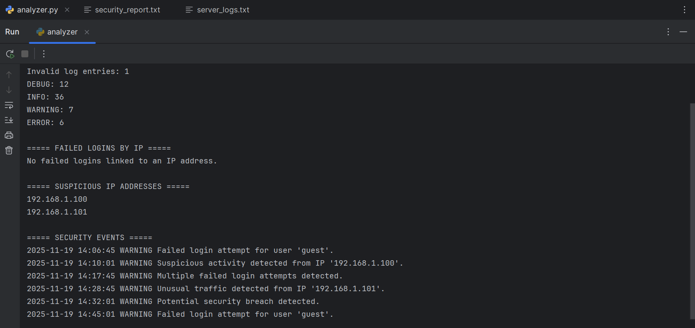
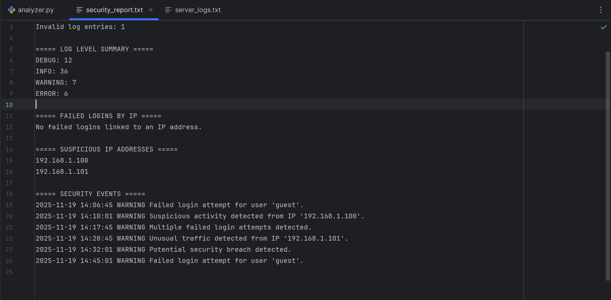
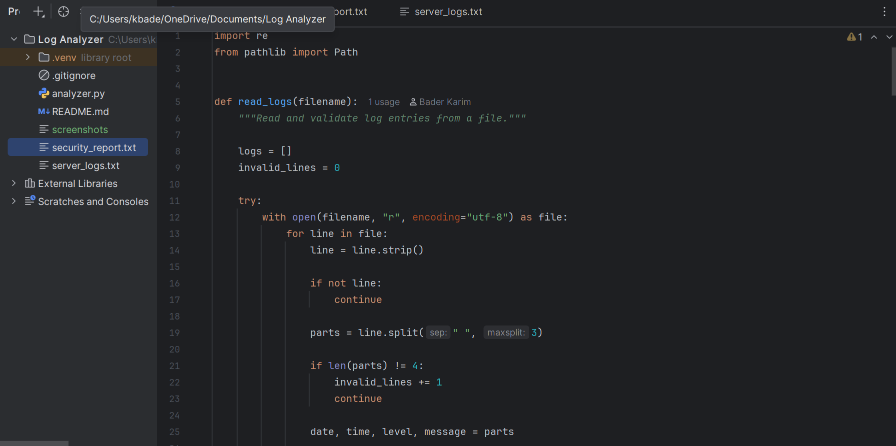

# Cybersecurity Log Analyzer 🔐

A Python-based tool that analyzes server log files, summarizes system activity, and identifies potential security-related events.

## 🎯 Project Overview

This project was developed to practise Python programming and explore basic cybersecurity log analysis.

It processes server logs, extracts useful information, detects selected security-related keywords, and generates a readable security report.

## ✨ Features

- Log parsing and validation.
- Counting DEBUG, INFO, WARNING, and ERROR messages.
- Detection of potential security events.
- IPv4 address extraction using Regular Expressions.
- Tracking unique suspicious IP addresses.
- Counting failed login attempts when an IP address is available.
- Automatic report generation.

## 🛠️ Technologies Used

- Python 3
- Regular Expressions (Regex)
- File Handling
- Lists, Dictionaries, and Sets
- Exception Handling

## 📁 Project Structure

```text
Cybersecurity-Log-Analyzer/
├── .gitignore
├── README.md
├── analyzer.py
├── server_logs.txt
└── security_report.txt
```

## 🚀 Getting Started

### Requirements
- Python 3 installed on your computer.

### Run the project

1. Clone the repository:

```bash
git clone https://github.com/deathrow01/Cybersecurity-Log-Analyzer.git
```

2. Open the project folder:

```bash
cd Cybersecurity-Log-Analyzer
```

3. Run the analyzer:

```bash
python analyzer.py
```

The program reads `server_logs.txt`, displays the analysis, and generates `security_report.txt`.

## 🔍 How It Works

1. Reads and validates server log entries.
2. Extracts the date, time, log level, and message.
3. Counts messages by log level.
4. Searches for selected security-related keywords.
5. Extracts IP addresses from matching messages.
6. Generates a security report.

## 📸 Screenshots

### 1. Terminal Output
Shows the log analysis results and detected security events.



### 2. Generated Security Report
Shows the report automatically generated by the Python analyzer.



### 3. Project Structure
Shows the organization of the project files in PyCharm.



## ⚠️ Limitations

This is an educational project based on keyword detection. It does not confirm that an attack has occurred or replace professional security monitoring systems.

Failed login attempts are associated with an IP address only when the log message contains one.

## 👨‍💻 Author

**Badr Eddine Karim**

GitHub: [@deathrow01](https://github.com/deathrow01)